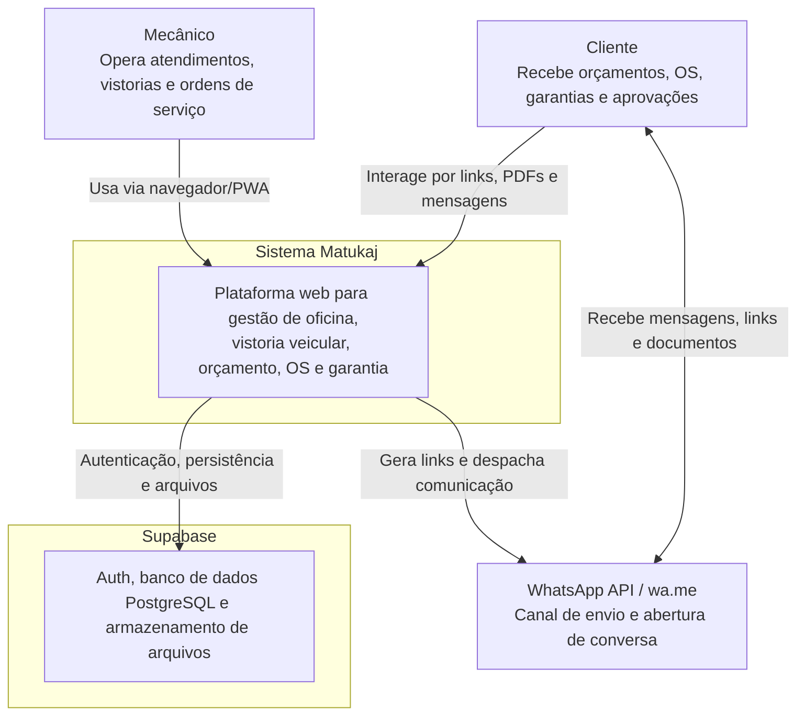
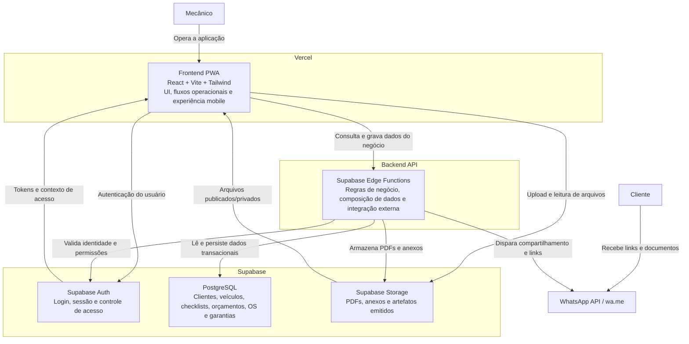
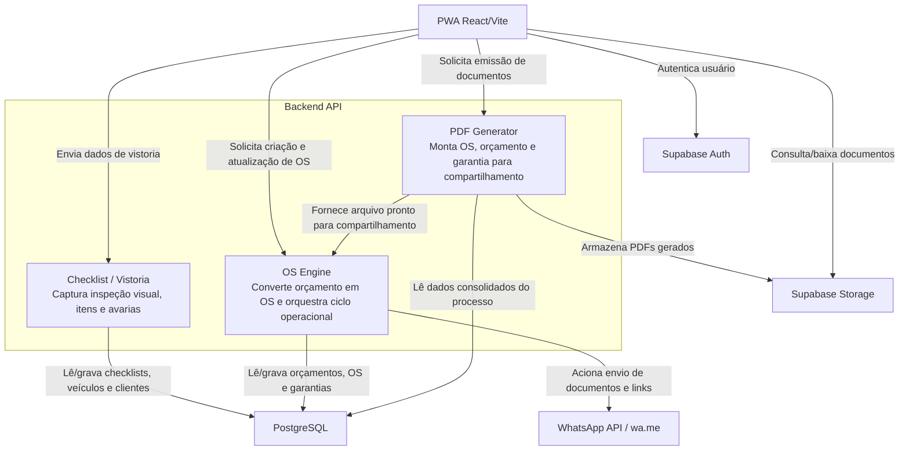

# Arquitetura Técnica e de Dados - Modelo C4

Este documento descreve a arquitetura do sistema **Matukaj** em 3 níveis do modelo C4, usando diagramas Mermaid compatíveis com o preview do GitHub.

## Nível 1 - Contexto

## Nível 2 - Contêineres

## Nível 3 - Componentes

## Observações de Arquitetura

- O **Frontend PWA** concentra a experiência operacional do mecânico e pode funcionar como interface principal em desktop e mobile.
- O **Supabase** atua como núcleo de dados, autenticação e armazenamento de artefatos do sistema.
- O **Backend API** encapsula regras de negócio e integrações, mantendo o frontend desacoplado da lógica operacional.
- O fluxo de **WhatsApp** é orientado a compartilhamento de links e documentos gerados, incluindo uso de `wa.me` quando aplicável.
